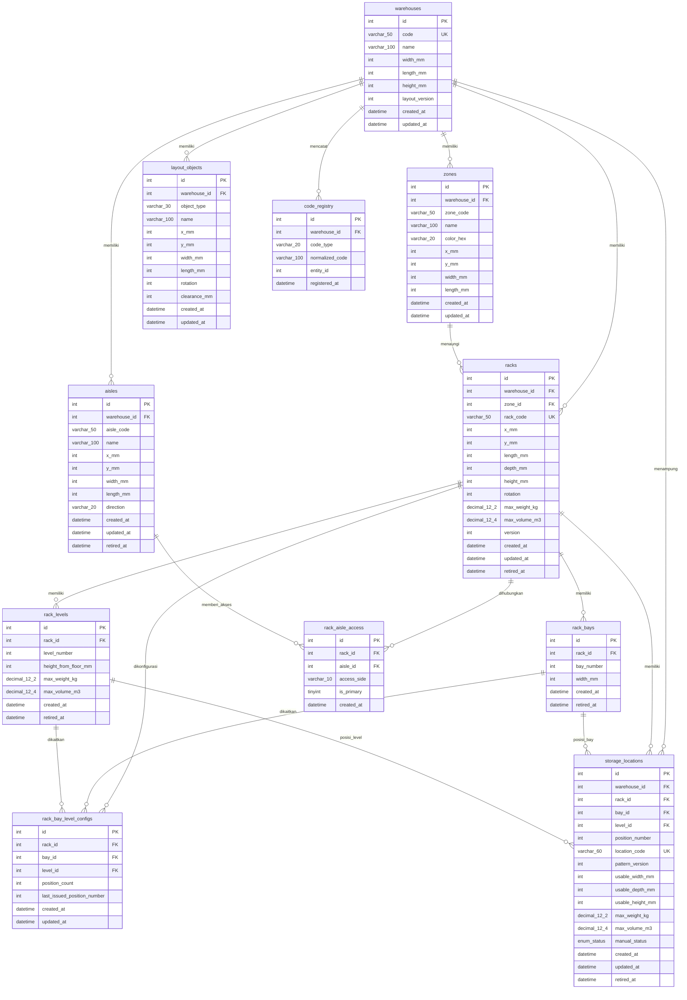

# ANALISIS REPO & ERD: WAREHOUSE LAYOUT & STORAGE MAPPING (STEP 0)

> **Status:** Selesai Analisis  
> **Tanggal:** 2026-11-18  
> **Penyelarasan Stack:** React 19 (JSX) + Node.js Express (CommonJS) + MySQL (`smart_warehouse_db`)  

---

## 1. Pemetaan Arsitektur Repositori Susuno

### 1.1 Struktur Workspace
Susuno menggunakan struktur *polyrepo workspace* dalam satu root:
- `backend/`: Layanan REST API Node.js / Express.
- `web/`: Web Management Console React 19 + Vite.
- `mobile/`: Aplikasi mobile Flutter (Staf Lapangan).
- `docs/`: Dokumentasi arsitektur, rute (`routes.md`), gaya desain (`design.md`), aturan (`development-rules.md`).
- `ai/`: Modul analitik heuristik & prediksi stok.

### 1.2 Frontend Web Stack (`web/`)
- **Framework & Bundler:** React 19.2.0, Vite 7.1.7 (ESM, type: "module").
- **Bahasa:** JavaScript murni (`.jsx`, `.js`), tanpa TypeScript.
- **Routing:** State-driven routing berbasis custom state machine di `web/src/App.jsx` (`step` state yang disinkronkan dengan HTML5 History API: `ROUTE_PATH_MAP` dan `PATH_ROUTE_MAP`).
- **State Management:** React native hooks (`useState`, `useRef`, `useCallback`, `useMemo`). Tidak menggunakan Redux/Zustand global.
- **Server-State / Fetching:** Native `fetch` yang dibungkus dalam modul terpusat `web/src/utils/api.js`.
- **UI Library / Styling:** Vanilla CSS terpisah per modul di `web/src/styles/` dengan tema *Modern Industrial Forest & Clean Ergonomic Warehouse* (`#5c732b` Olive, `#3e5510` Forest, `#191d17` Ink Charcoal, `#f8f9f5` Canvas).

### 1.3 Backend Stack (`backend/`)
- **Runtime & Framework:** Node.js, Express 5.2.1, CommonJS (`type: "commonjs"`, menggunakan `require`).
- **Bahasa:** JavaScript murni (`.js`), tanpa TypeScript.
- **Database Engine & Driver:** MySQL 8.x / MariaDB menggunakan driver `mysql2/promise` dengan connection pooling di `backend/config/db.js`.
- **ORM / Query Builder:** Tidak menggunakan ORM (seperti Prisma/TypeORM/Sequelize). Semua kueri berupa raw parameterized SQL (`db.query('SELECT ... WHERE id = ?', [id])`) di dalam file model (`backend/models/`).
- **Migration Tool:** Saat ini belum ada runner migrasi otomatis; skema dikelola melalui dump SQL di `backend/database/smart_warehouse_db.sql`.
- **Auth & RBAC:** JWT token (`jsonwebtoken`) divalidasi oleh `backend/middlewares/authMiddleware.js`. Peran yang didukung: `manager` dan `staf`. Terdapat fallback default manager di lingkungan pengembangan.
- **Audit Logging:** Menggunakan `backend/utils/audit.js` yang mencatat mutasi ke tabel `audit_logs` (`user_id`, `action`, `table_affected`, `record_id`).
- **Security & Middlewares:** `helmet`, `cors` dengan whitelist lokal, `express-rate-limit`, JSON body parser dengan limit 25MB.
- **Error Handling:** Centralized error handler di `backend/server.js` (HTTP status + JSON `{ message: '...' }`).
- **Test Framework:** Belum ada test framework terpasang di `package.json`. Untuk `layout-core` dan endpoint backend, kita akan memanfaatkan **Node.js Native Test Runner (`node:test` dan `node:assert`)** yang tersedia langsung di Node.js tanpa dependensi tambahan.

---

## 2. Perintah Proyek (Tercatat di PROGRESS.md)
- **Install:** `npm --prefix web install` dan `npm --prefix backend install`
- **Dev Web:** `npm --prefix web run dev` (Port 5173)
- **Dev Backend:** `npm --prefix backend run dev` (Port 5000)
- **Build / Lint Web:** `npm --prefix web run build`
- **Test Unit Core:** `node --test shared/layout-core/test/*.test.js`
- **Test Integrasi DB:** `node backend/modules/warehouse-layout/test/integration.test.js`
- **Migrasi DB:** `node backend/modules/warehouse-layout/database/migrate.js up / down`

---

## 3. Verifikasi Asumsi Blueprint (A1 - A6)

| Kode | Asumsi Asal Blueprint | Status di Susuno | Dampak & Penyesuaian |
|---|---|---|---|
| **A1** | Database PostgreSQL | **SALAH** | Susuno menggunakan **MySQL 8.x (`mysql2/promise`)**. Kueri, constraint CHECK, trigger immutability, partial index, dan compare-and-swap disesuaikan ke dialek MySQL InnoDB. |
| **A2** | Backend TypeScript | **SALAH** | Susuno menggunakan **JavaScript murni (CommonJS)**. Kode ditulis dalam format `.js` bersih dengan JSDoc type annotations. |
| **A3** | Frontend React TypeScript | **SALAH** | Susuno menggunakan **React 19 JSX murni**. Komponen dan Canvas 2D engine ditulis dalam `.jsx`/`.js` murni. |
| **A4** | Koordinat & Dimensi Integer mm | **BENAR** | Dipertahankan 100%. Satuan database dan logika domain murni integer milimeter (mm). Pixel hanya ada di layer render Canvas/SVG. |
| **A5** | Skala 500 Rak / 100.000 Lokasi | **BENAR** | Memerlukan keyset pagination (cursor-based), spatial hashing di klien/server, dan larangan memuat seluruh lokasi ke Top View Canvas. |
| **A6** | RBAC Manager & Staf | **BENAR** | Selaras dengan `users.role` ENUM('manager', 'staf') dan middleware `authorizeRole`. |

---

## 4. Analisis Entitas Database Existing

| Entitas | Status | Keterangan & Dampak pada Sistem Susuno |
|---|---|---|
| `warehouses` | **BARU** | Sebelumnya hanya berupa kolom string `users.warehouse`. Dibuatkan tabel master dengan dimensi batas (panjang, lebar, tinggi) dan kolom `layout_version`. |
| `zones` | **BARU** | Sebelumnya hanya kolom teks bebas `locations.zone` dan `products.zone_location`. Dibuat tabel formal berelasi ke `warehouse_id`. |
| `aisles` | **BARU** | Tabel baru untuk lorong akses, koordinat, dimensi, dan orientasi. |
| `racks` | **BARU** | Tabel master rak (koordinat x, y, panjang, lebar, tinggi, rotasi, kapasitas, version). |
| `rack_aisle_access`| **BARU** | Relasi many-to-many rak ke lorong dengan atribut `side` (left/right/both) dan `is_primary`. |
| `rack_bays` | **BARU** | Struktur bay fisik per rak dengan lebar individual. |
| `rack_levels` | **BARU** | Struktur level per rak dengan ketinggian dari lantai (`height_from_floor_mm`). |
| `rack_bay_level_configs` | **BARU** | Konfigurasi posisi per bay-level, menyimpan `position_count` dan `last_issued_position_number`. |
| `storage_locations` | **BARU / PENGGANTI** | Menggantikan tabel `locations` lama dengan data terstruktur lengkap. |
| `locations` (lama) | **DIPERLUAS / MIGRASI** | Tabel `locations` lama berisi 0 baris aktif. Kita buat tabel baru `storage_locations`, lalu sediakan VIEW atau backward-compatibility wrapper untuk kolom `products.location_id`. |
| `code_registry` | **BARU** | Tabel registry permanen anti-reuse kode rak dan kode lokasi, tanpa relasi CASCADE. |
| `layout_objects` | **BARU** | Rintangan layout (tiang, dinding, pintu, loading dock). |
| `products` | **DIPAKAI ULANG** | Kolom `location_id` di `products` akan mengacu ke `storage_locations.id`. |
| `audit_logs` | **DIPAKAI ULANG** | Mencatat aksi layout (`LAYOUT_UPDATED`, `RACK_CREATED`, `LOCATIONS_GENERATED`, dll.). |

---

## 5. Rancangan ERD MySQL (Mermaid)



---

## 6. Penegakan Aturan Integritas pada MySQL (InnoDB)

1. **Primary Aisle (Maksimal 1 & Minimal 1 per Rak Aktif):**
   - *Maksimal 1 Primary:* Ditegakkan dengan kolom virtual generated di MySQL atau Trigger `BEFORE INSERT / UPDATE` pada `rack_aisle_access` yang menolak jika sudah ada `is_primary = 1` pada `rack_id` tersebut.
   - *Minimal 1 Primary:* Divalidasi saat rak diaktifkan/dibuat di dalam transaksi API backend.
2. **Kode Immutable (`rack_code` & `location_code`):**
   - Ditegakkan dengan **MySQL Trigger**:
     ```sql
     CREATE TRIGGER trg_racks_prevent_code_update
     BEFORE UPDATE ON racks FOR EACH ROW
     BEGIN
       IF OLD.rack_code <> NEW.rack_code THEN
         SIGNAL SQLSTATE '45000' SET MESSAGE_TEXT = 'Dilarang mengubah rack_code (immutable).';
       END IF;
     END;
     ```
   - Hal yang sama berlaku pada `storage_locations.location_code`.
3. **Kode Permanen Anti-Reuse (`code_registry`):**
   - Kolom `(warehouse_id, code_type, normalized_code)` memiliki indeks `UNIQUE`.
   - Tidak ada `ON DELETE CASCADE` dari tabel `racks` atau `storage_locations` ke `code_registry`. Sekali kode terbit, ia tetap tercatat selamanya.
4. **Composite Foreign Key (Bay & Level Berasal dari Rak yang Sama):**
   - MySQL InnoDB mendukung composite foreign key. Tabel `rack_bays` memiliki unique key `(rack_id, id)` dan `rack_levels` memiliki unique key `(rack_id, id)`.
   - Tabel `storage_locations` memiliki constraint composite:
     `FOREIGN KEY (rack_id, bay_id) REFERENCES rack_bays(rack_id, id)` dan
     `FOREIGN KEY (rack_id, level_id) REFERENCES rack_levels(rack_id, id)`.
5. **Optimistic Locking pada Layout:**
   - Perubahan layout menggunakan pola Compare-And-Swap (CAS):
     `UPDATE warehouses SET layout_version = layout_version + 1 WHERE id = ? AND layout_version = ?`
   - Jika `affectedRows === 0`, backend mengembalikan respons `409 VERSION_CONFLICT`.
6. **Transaksi Generator Lokasi:**
   - Kueri dijalankan dalam satu transaksi InnoDB (`START TRANSACTION`).
   - Rak dikunci dengan `SELECT id, last_issued_position_number FROM rack_bay_level_configs WHERE rack_id = ? FOR UPDATE`.
   - Batch insert lokasi dilakukan secara terchunk (1.000–5.000 baris per query `INSERT INTO storage_locations (...) VALUES (...)`) untuk mencegah memory exhaustion dan lock timeout.

---

## 7. Usulan Struktur Folder Modular Terpisah (Pure JS)

```text
Susuno/
├── shared/layout-core/                # [Logika Murni Geometri & Validasi]
│   ├── src/
│   │   ├── geometry.js                # Footprint, rotasi CW 90, overlap AABB, inside, snap
│   │   ├── spatialHash.js             # Indeks spatial seragam untuk query cepat
│   │   ├── codeNormalizer.js          # Normalisasi kode & regex pattern
│   │   └── structureRules.js          # Validasi lebar bay, tinggi level, clearance
│   └── test/                          # Unit test native (node:test)
│       └── geometry.test.js
│
├── backend/modules/warehouse-layout/  # [Modul Backend Terisolasi]
│   ├── controllers/
│   │   ├── layoutController.js        # Snapshot GET, Batch PATCH, layout object
│   │   ├── rackController.js          # CRUD rak, elevasi, konfigurasi bay-level
│   │   ├── generatorController.js     # Preview & generate kode lokasi
│   │   └── directoryController.js     # Keyset pagination pencarian lokasi
│   ├── services/
│   │   ├── layoutValidationService.js # Validasi batas gudang, collision, clearance
│   │   ├── batchPatchService.js       # Eksekusi batch patch compare-and-swap
│   │   └── locationGeneratorService.js# Pembuatan lokasi chunked + registry
│   ├── routes/
│   │   └── layoutRoutes.js            # Router Express khusus /api/warehouse-layout/*
│   └── database/
│       ├── migrations/                # Script SQL DDL up & down
│       └── migrate.js                 # Runner migrasi mandiri
│
├── web/src/features/warehouse-layout/ # [Frontend Feature Terisolasi]
│   ├── engine/                        # Mesin Canvas 2D murni (tanpa re-render React saat drag)
│   │   ├── viewport.js                # Pan, zoom berpusat kursor, transform matrix
│   │   ├── renderer.js                # Render loop requestAnimationFrame, LOD, culling
│   │   └── pointerEvents.js           # Hit-test, selection, ghost drag
│   ├── elevation/                     # Rack Elevation SVG
│   │   └── RackElevationSvg.jsx       # Render struktur bay-level-position
│   ├── editor/                        # Komponen Editor & Toolbar
│   │   ├── documentStore.js           # Store lokal editor + history undo/redo (max 100)
│   │   ├── LayoutToolbar.jsx          # Alat tambah rak, zona, lorong, rintangan
│   │   └── PropertyPanel.jsx          # Panel numerik mm/cm/m koordinat
│   ├── directory/                     # Location Directory Virtual List
│   │   └── LocationDirectory.jsx      # Keyset pagination + virtual scrolling
│   └── pages/
│       └── WarehouseLayoutPage.jsx    # Halaman utama (di-mount ke App.jsx via React.lazy)
│
└── docs/warehouse-layout/             # Dokumentasi & Progress
    ├── AGENT_PROMPT.md
    ├── PROGRESS.md
    ├── ANALYSIS.md
    └── COLLISION-MATRIX.md
```

---

## 8. Evaluasi Baseline Performa Frontend & Code-Splitting

- **Hasil Build Saat Ini (`npm --prefix web run build`):**
  - Bundle JavaScript utama monolitik: `dist/assets/index-gCxuq4j9.js` = **885.93 KB (gzip: 239.85 KB)**.
  - CSS utama: `dist/assets/index-1pVG9q5i.css` = **261.88 KB (gzip: 44.30 KB)**.
  - Saat ini **belum ada code-splitting**; semua halaman diimpor secara statis di `App.jsx`.
- **Strategi Pemenuhan Anggaran (Chunk Editor <= 60 KB gzip):**
  - Halaman `WarehouseLayoutPage` **wajib dimuat secara dinamis** menggunakan `React.lazy(() => import(...))` dengan `Suspense` di `App.jsx`.
  - Mesin Canvas 2D ditulis menggunakan Canvas API bawaan browser tanpa library eksternal (beban library = 0 KB).
  - Dengan pendekatan ini, chunk `warehouse-layout` dapat dengan mudah memenuhi target <= 60 KB gzip.

---

## 9. Rencana Migrasi Data Existing

1. Tabel `locations` yang ada saat ini di `smart_warehouse_db.sql` hanya memiliki skema dasar dan belum memiliki data transaksi aktif.
2. Kolom `products.location_id` saat ini bertipe `INT(11) NULL`.
3. Skrip migrasi akan:
   - Membuat skema tabel baru (`warehouses`, `zones`, `aisles`, `racks`, `storage_locations`, `code_registry`, dll.).
   - Menyediakan 1 warehouse default ("Main Warehouse") yang diselaraskan dengan data profil pengguna di `users.warehouse`.
   - Memastikan `products.location_id` mereferensikan `storage_locations.id`.
   - Mengisi `code_registry` untuk seluruh kode yang ada.

---

## 10. Evaluasi Keputusan Terkunci (D1 - D20) terhadap Repositori

| No | Keputusan | Evaluasi & Status Kepatuhan |
|---|---|---|
| **D1** | Integer mm untuk koordinat & dimensi | **PATUH**. Seluruh tabel dan logika `layout-core` menggunakan integer mm. |
| **D2** | Rotasi 0, 90, 180, 270 derajat (AABB) | **PATUH**. Check constraint pada MySQL `rotation IN (0, 90, 180, 270)`. |
| **D3** | Top View Canvas 2D & Elevation SVG | **PATUH**. Native Canvas 2D di frontend, SVG murni untuk tampak depan rak. |
| **D4** | Larangan full load 100.000 lokasi ke Top View | **PATUH**. Top View hanya memuat metadata rak, zona, lorong. Lokasi hanya dimuat lewat Keyset Directory / Elevation. |
| **D5** | Immutability kode rak & lokasi | **PATUH**. MySQL Triggers menolak perubahan kode setelah terbit. |
| **D6** | Tinggi level seragam per rak untuk semua bay | **PATUH**. Tabel `rack_levels` mengikat `rack_id`, berlaku ke seluruh bay pada rak tersebut. |
| **D7** | Posisi fleksibel per bay-level | **PATUH**. Disimpan di tabel `rack_bay_level_configs.position_count`. |
| **D8** | Soft delete / retire untuk entitas berhistori | **PATUH**. Menggunakan kolom `retired_at` dan penolakan hard-delete jika ada transaksi. |
| **D9** | Optimistic locking via `layout_version` | **PATUH**. Compare-and-swap di database menghasilkan HTTP 409 saat ada konflik. |
| **D10**| Validasi geometri otoritatif di Backend | **PATUH**. Frontend hanya memberi saran visual; backend mengeksekusi validasi deterministik. |
| **D11**| Undo/Redo command pattern (maks 100) | **PATUH**. Diimplementasikan di DocumentStore editor frontend. |
| **D12**| Akses lorong eksplisit (bukan proximity) | **PATUH**. Ditentukan lewat relasi `rack_aisle_access`. |
| **D13**| Versi pattern kode lokasi | **PATUH**. Kolom `pattern_version` disimpan per lokasi tanpa merubah kode lama. |
| **D14**| Keyset pagination untuk direktori | **PATUH**. Menggunakan cursor query `WHERE (warehouse_id, location_code) > (?, ?) LIMIT ?`. |
| **D15**| Larangan tombol dekorasi / Phase 3 dummy | **PATUH**. Tab inventori hanya menampilkan empty state "Belum terhubung ke inventori". |
| **D16**| Append-first location generator | **PATUH**. Menggunakan `last_issued_position_number` per bay-level. |
| **D17**| DECIMAL untuk kapasitas berat & volume | **PATUH**. Tipe kolom `DECIMAL(12,2)` (kg) dan `DECIMAL(12,4)` (m3). Dilarang float. |
| **D18**| Audit log dalam transaksi yang sama | **PATUH**. Pencatatan audit dieksekusi di dalam blok `START TRANSACTION` yang sama. |
| **D19**| State interaksi di ref (tanpa re-render panel saat drag) | **PATUH**. Mouse/pointer drag ditangani di ref native; commit ke React state hanya saat pointerup. |
| **D20**| Target performa >= 55 fps pada 500 rak (4x CPU Throttle) | **PATUH**. Culling spatial hash + render rAF dirty-only. |

---

## 11. Jawaban & Rekomendasi Pertanyaan Terbuka (K1 - K9)

1. **K1 (Lokasi layout-core):** Ditempatkan di `shared/layout-core/`. Modul JavaScript murni yang dapat di-*import* langsung oleh Express di backend dan Vite di web tanpa proses kompilasi rumit.
2. **K2 (Mekanisme Migrasi DB):** Dibuatkan runner migrasi sederhana berbasis file SQL (`migrate.js`) yang mengeksekusi script up dan down secara sekuensial dan idempotent pada MySQL.
3. **K3 (Titik Pusat Rotasi):** Rotasi 90° searah jarum jam (CW) terhadap titik pusat bounding box rak, dengan koordinat sudut kiri-atas dibulatkan menggunakan `Math.floor`.
4. **K4 (Semantik Pencarian Aisle):** Menggunakan status akses primary aisle rak saat ini (live query JOIN ke `rack_aisle_access` dengan `is_primary = 1`).
5. **K5 (Index Pencarian Keyset):** B-Tree composite index pada `(warehouse_id, location_code)` untuk prefix search, dikombinasikan dengan cursor ID.
6. **K6 (Draft Recovery di Klien):** Disarankan ditunda hingga STEP 7. Prioritaskan konfirmasi `beforeunload` saat form dirty agar tidak terjadi inkonsistensi versi draft lama.
7. **K7 (Pemetaan Hak Akses RBAC):** Role `manager` diberikan wewenang penuh (`layout.view`, `layout.edit`, `location.configure`). Role `staf` hanya diberikan wewenang `layout.view` (read-only).
8. **K8 (Verifikasi Riwayat Sebelum Phase 3):** Memeriksa referensi pada `products.location_id` dan tabel `stock_transactions`. Jika pernah tercatat, entitas hanya boleh di-retire (`retired_at`), bukan dihapus fisik.
9. **K9 (Kunci Konkurensi MySQL):** Menggunakan klausa `SELECT layout_version FROM warehouses WHERE id = ? FOR UPDATE` di dalam transaksi InnoDB.

---

## 12. Catatan Keputusan Operasional Phase 3 (Terbuka, Belum Diimplementasikan)
- Integrasi stok real-time (single-SKU vs mixed-SKU per lokasi).
- Aturan reservasi stok, picking alur lorong, dan algoritma putaway otomatis.
- Seluruh UI pada Phase 1-2 menampilkan tab inventori dengan status informatif: *"Belum terhubung ke inventori"*, sesuai kriteria AC-20.

---

## 13. Rencana Implementasi Bertahap (STEP 1 - 13)

- **STEP 1 (`shared/layout-core`):** Logika murni matematika geometri AABB, spatial hash, normalisasi kode, unit test native `node:test`.
- **STEP 2 (`backend/database`):** File migrasi MySQL DDL up/down, triggers immutability, foreign key composite, test rollback.
- **STEP 3 (`backend/api` CRUD):** Endpoint CRUD gudang, zona, lorong, rak, objek layout dengan validasi collision service.
- **STEP 4 (`backend/api` Snapshot & Batch):** GET snapshot (ETag/304), PATCH batch versioning compare-and-swap (HTTP 409).
- **STEP 5 (Seed & Harness):** Seeder 500 rak dan 100.000 lokasi sintetis, harness pengujian FPS dan bundle size.
- **STEP 6 (`web/engine` Canvas 2D):** Viewport transform, spatial culling, LOD, pointer capture, pengujian FPS pada 500 rak.
- **STEP 7 (`web/editor`):** Document store, undo/redo patch-based (100 step), toolbar, property panel, save batch, penanganan 409.
- **STEP 8 (`backend/structure`):** API elevasi rak, preview diff bay/level, validasi kapasitas agregat.
- **STEP 9 (`web/elevation` SVG):** Komponen SVG tampak depan rak, form struktur, hit-test koordinat pointer.
- **STEP 10 (`backend/generator`):** Generator lokasi chunked (1.000-5.000 baris), append-first, registry kode anti-reuse.
- **STEP 11 (`web/generator` UI):** Preview diff kode lokasi, konfirmasi batch, setting pattern versi baru.
- **STEP 12 (`full-stack` Directory & Inspector):** Keyset pagination cursor, virtual scroll, modal inspeksi lokasi (clean empty state inventori).
- **STEP 13 (Hardening & Audit Akhir):** Audit bukti kriteria penerimaan AC-01 s/d AC-30, pengujian performa, verifikasi aksesibilitas dan keamanan.

---

Menunggu persetujuan sebelum implementasi.
